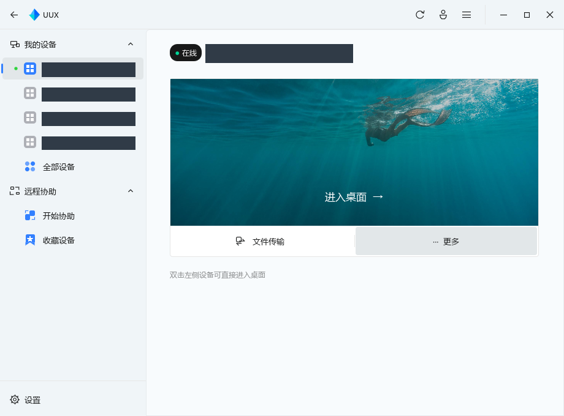
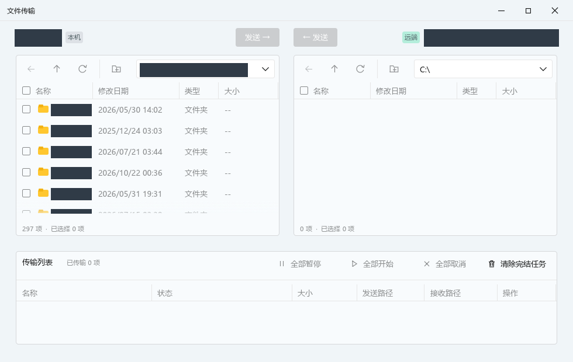

<p align="center">
  
</p>

<p align="center">
  <a href="#功能">功能</a> · <a href="#mcp">MCP</a> · <a href="#构建">构建</a>
</p>

UUX 是使用 **Rust + egui** 构建的非官方 Linux 原生 UU 远程主控端，连接官方 UU 被控端。软件启动秒开，运行时无需 Wine、Python、官方主控客户端或 Windows DLL。

## 截图



<details>
<summary>文件传输</summary>



</details>

## 功能

- **设备与协助**：扫码登录、设备列表、收藏、验证码远程协助。
- **远控与显示**：H.264/H.265、软件与硬件解码、键鼠与输入法文字、触摸输入；多屏标签、超级屏、虚拟屏、分辨率及 DPI 设置。
- **声音与文件**：桌面声音、麦克风发送；文字、图片和文件剪贴板；双向文件传输、多选、暂停／继续、进度与速度显示。
- **终端与网络**：PowerShell 交互终端、命令执行、TCP 端口映射。
- **共享会话**：单实例启动，GUI 与 MCP 共用账号和连接；远控、文件、终端、映射和媒体订阅分别持有会话。
- **MCP 自动化**：设备管理、截图与输入、文件任务、终端、映射及 H.264/H.265、Opus 原始媒体流订阅。

## MCP

在「设置 → MCP」开启服务并复制配置，或在 MCP 客户端中添加：

```json
{
  "mcpServers": {
    "uux": {
      "command": "uux",
      "args": ["--mcp"]
    }
  }
}
```

`uux` 需位于 `PATH`；否则将 `command` 改为可执行文件的绝对路径。GUI 和 MCP 使用同一份登录状态。

## 构建

需要 **Rust 1.95+**、C/C++ 编译器、Clang、`pkg-config`、`protoc`，以及 FFmpeg 9、Opus、ALSA、PulseAudio 开发库。

在本仓库根目录执行：

```sh
cargo build --release --locked
./target/release/uux
```
